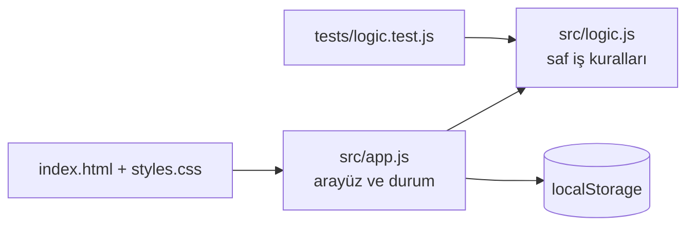

# Mini Blog

[](https://github.com/ahmetbolukoglu/mini-blog/actions/workflows/appnar.yml)
[](https://ahmetbolukoglu.github.io/mini-blog/)


> Kişisel yazılarınızı taslaklardan yayımlayın ve etiketleyin

**Canlı demo:** https://ahmetbolukoglu.github.io/mini-blog/

Mini Blog, kişisel yazılarınızı kolayca taslaklardan yayımlayabileceğiniz, etiketleyebileceğiniz ve yönetebileceğiniz basit bir blog uygulamasıdır. Yazma sürecinizi destekleyerek, içeriklerinizi düzenli ve organized bir şekilde oluşturmanıza yardımcı olur. Özellikle blog yazarları, içerik oluşturucular ve kişisel not tutanlar için idealdir.

## Özellikler

- ✍️ Yazı taslakları ve yayın yönetimi
- 🏷️ Etiketleme ve kategori yönetimi  
- 📝 Yazı ekleme, düzenleme ve silme
- 🔍 Etiketlere göre filtreleme
- 📅 Yazıların yayın tarihi yönetimi
- 🔢 Yazıları sıralama ve arama
- 📤 Veri dışa aktarma ve içe aktarma

## Nasıl çalışır



## Yerelde çalıştır

```bash
git clone https://github.com/ahmetbolukoglu/mini-blog.git
cd mini-blog
npx serve .        # veya herhangi bir statik sunucu
npm test
```

Bağımlılık yok: düz HTML, CSS ve JavaScript modülleri.

## Proje yapısı

```
index.html          sayfa iskeleti
styles.css          tasarım, açık/koyu tema
src/app.js          arayüz ve kalıcı durum
src/logic.js        saf fonksiyonlar (test edilir)
tests/              node:test birim testleri
docs/PLAN.md        ürün planı
```

## Lisans

MIT © 2026 ahmetbolukoglu

---
<sub>Bu repo [AppNar](https://github.com/topics/appnar) ile üretildi.</sub>
